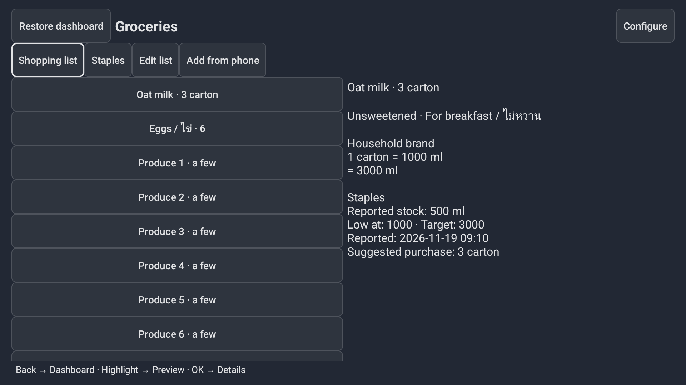
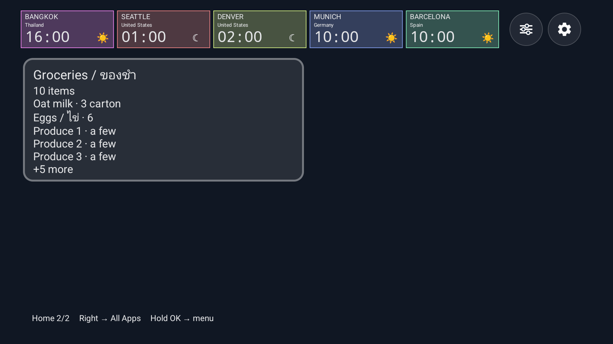
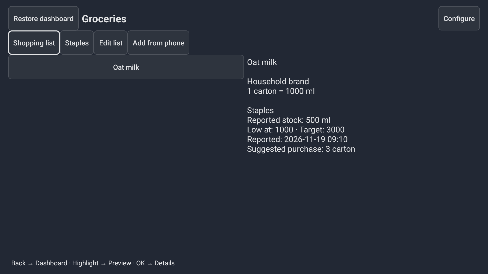

# Groceries Phase 1/2 verification

Implementation branch: `feature/grocery-list`, worktree `.worktrees/grocery-list`,
based on `eb9adf6`. This branch does not include the main checkout's unrelated
uncommitted publication, cleanup or default-favorite changes. It is not merged.

## Container checks

- `task check`: 506 Java tests, 7 calendar pipeline tests, 60 cleanup/recovery
  tests, 2 deployment tests and Android lint passed. English/Thai resource parity
  validated 692 Homeboard resources.
- `task phone:check`: shared draft/rebase logic, Chromium/Android and WebKit/iPhone
  controller workflows and World clock regression checks passed. The existing
  preview check now waits for the asynchronous preview response before asserting.
- `task grocery:check`: exact decimal conversion, confirmed package sizes,
  threshold boundaries, whole-package/loose-increment rounding, unknown/manual
  stock, free-text preservation, per-list conflicts and independent-list merge
  passed. Real Chromium/WebKit phone checks cover quick Add/Enter, batch preview,
  Thai input, duplicate review, staple reuse, keyboard reorder, confirmed units,
  low-stock suggestions, atomic Update TV and large text. An additional open-editor
  rebase check verifies explicit conflict resolution and clearing local draft Undo
  after a committed update.
- The first new Java check exposed snapshot aliasing; the phone snapshot now
  copies the grocery book. Both validation paths reject missing product links,
  duplicate product needs, invalid units/stock, unknown schema fields on the server,
  oversized text and over-budget data without partial persistence.

Phone fixture captures are under `artifacts/phone-browser/grocery-*.png`. They
establish rendered browser behavior against controlled responses, not physical
phone-to-TV LAN reachability.

## Deployments and native evidence

Build `0.1.75` is superseded: artifact inspection caught the final phone Undo fix
missing from its packaged asset. It must not be used as final acceptance evidence.
Its frozen APK SHA-256 is
`5ba1c3815af733fa158ab7c0fc0b52fff564e1cec6e4c1789995d44345a8dff6`.
Cast1 install `J‑ef3c91a6eddd` succeeded; the identical Cast2 install
`J‑9687c19ce309` failed `personal-install-in-use` and is unconfirmed.

The `0.1.75` isolated native proof `J‑e36bb5de09d6` encountered coordinator
`plugin-error` / recovery-required before acceptance completed. Automatic recovery
`J‑b3cff08b419c` completed. This establishes no grocery UI pass. Exported evidence
belongs under `artifacts/grocery-proof/0.1.75/`.

Build `0.1.76` passed `task deploy` container checks and packaging. Its frozen
source hashes and every packaged phone asset matched the tested source. SHA-256:
`c59a50d4af7294c315224f83aa26852fca4d9991458ab2ca54f4bfcadd308bf8`.
Cast1 `J‑d08678ee5c90` succeeded; Cast2 `J‑e14a865782e9` failed
`personal-install-in-use`. Native proof `J‑a932da58285f` completed at the
coordinator, but its app assertion ran before content mounted and reported
`Expanded notes unavailable`. Its physical screenshot shows those notes, package
conversion and stock detail correctly; this is partial rendering evidence, not a
passed restoration check.

Build `0.1.77` replaces the probe's fixed mount delay with content-readiness polling,
cleans the grocery deletion label and removes a whitespace-only asset artifact.
It passed the same container checks and packaging workflow. All frozen source
hashes and packaged phone files match the tested source. Frozen SHA-256:
`ca5025be5382f0dc92072e3d1771b957f649aa97a3b34a5380e947b738958af9`.
Cast1 install/launch job `J‑0ed8949eeea1` succeeded. The identical Cast2 install
`J‑6d5a97623f3d` was admitted but failed `personal-install-in-use`; installation
there remains unconfirmed. The final isolated Cast1 proof is `J‑132e4dfbd8ec`.
Code/design commit: `15f1061`; subsequent changes to this record only document
acceptance. The branch remains separate from main.

The 0.1.77 proof reached nested Back/restoration but inspected the retained
Dialog reference before Android delivered `OnDismissListener`. It reported
`Expansion retained`; the physical capture shows the correct Home 2/2 page,
focused 4×2 grocery panel and honest +5 overflow. This is partial acceptance, not
a full pass. Build `0.1.78` changes only the debug probe to wait for both content
mounting and the asynchronous dismissal callback before checking restoration.
Production grocery behavior is unchanged from 0.1.77.





The debug-only `GroceryProbeActivity` uses isolated preferences and sample data,
checks the real aggregate phone Apply/retry/Undo path, real short/held OK dispatch,
nested Back, visible Restore, exact page/focus/geometry preservation and richer
product/stock detail. Run it only through the coordinator:

```sh
python3 dev/grocery-device-proof.py --version 0.1.78
```

A coordinator completion alone is not a pass: inspect its `wf.log`, version and
screenshots. No shared-device settings, default Home application or household
list is changed by the fixture.

## Final 0.1.78 result

**Cast1 native acceptance passed**, coordinator job `J‑99f8e34e7024`; its `wf.log`
reports `status: pass` and `homeboardVersion: 0.1.78`. The readiness-based probe
verified short/held OK, nested Back, visible Restore dashboard, original Home page,
focus and dimensions, unchanged list/geometry while browsing, native aggregate
Apply/retry/Undo and richer staple stock details. Household preferences remained
unchanged. Registration was restored to MainActivity after the probe.

Cast1 install/launch: `J‑209162786ea2`, succeeded. The identical Cast2 install
`J‑96947f9dc3f6` was submitted and admitted, but failed `personal-install-in-use`;
installation is **unconfirmed**, not queued or complete. Its evidence was exported.
No hold, launcher selection or app data was changed to bypass that precondition.

Final frozen APK SHA-256:
`648309915387f4e07272aa6a596a1cbf81cf4e89dfd2ca82236944a27ae7d16a`.
All recorded source hashes and every packaged phone asset match the tested source.
The final container run passed; browser source differs from the previously passing
grocery checks only by whitespace cleanup. Changes after the feature commit are
the debug acceptance probe, deployment version and documentation/evidence.



## Remaining limits

- Real physical phone LAN pairing/connectivity and English/Thai TV rendering with
  larger text require independent device acceptance.
- The remote editor provides basic list entry/editing and list selection. Product,
  packaging and stock configuration is phone-first; expanded TV views expose the
  saved details. Category metadata is retained; store/category grouping remains
  a follow-up.
- Phase 3 purchase completion, offline shopping and remote/cross-TV sync are absent.
  Stock changes only from explicit reports. Review schedules and natural-language
  Smart Add interpretation from the Remember The Milk survey remain later work.
