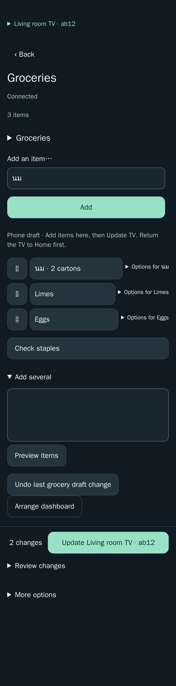
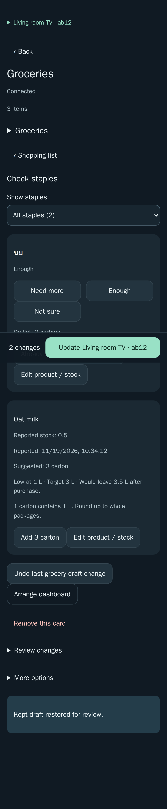
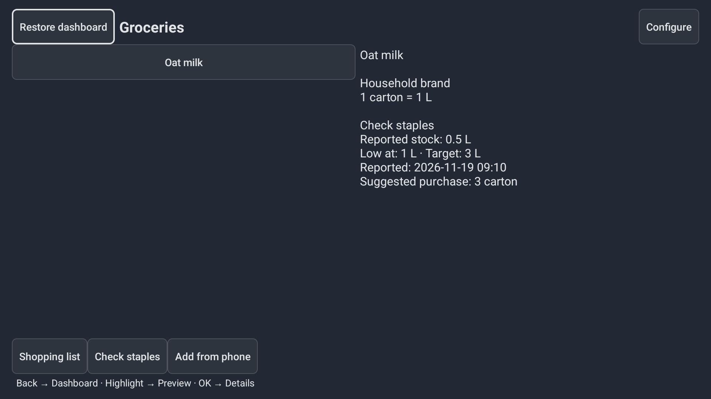

# Grocery Cooper revision verification

November 19, 2026 · `feature/grocery-list` in `.worktrees/grocery-list`.
Implements the [Cooper review](../plans/2026-11-19-grocery-goal-directed-design.md)
using the [shared filter v1.0](/home/will/docs/howtos/alan-cooper-design-filter.md).
Main was merged before this revision, retaining current publication, cleanup and
YouTube-default work. The feature remains separate from main.

## Scenarios checked in containers

| Check | Result and boundary |
|---|---|
| `task grocery:check` | Passed: exact decimal/package rules, independent-list rebase, TV-owned buffers, incomplete-value recovery and conflict checks. |
| Chromium + WebKit, 390×844 | Passed: Add before management, three English/Thai names with Enter and retained focus, batch preview, keyboard movement and lossless pointer cancellation. |
| Reuse and staples | Passed: one-tap known-item reuse, no silent increase, text fallback for an unconfirmed `packet`, counted filters, simple stock and retained needs after Enough. |
| Familiar quantities | Passed: 1 L carton, 0.5 L / 1 L / 3 L explanation, whole-carton rounding, inline incompatible-unit correction without clearing the amount. |
| Package correction | Passed: changing 1 L to 0.75 L previews the existing 3-carton need as 2.25 L. An explicit **Change 3 carton → 4 carton** updates that need, retaining the 500 ml stock report. |
| Draft recovery | Passed: Back retains ordinary changes; Cancel discards only the open edit; an empty name and unfinished note survive reload and explicit draft recovery. Invalid display input blocks publication even when the normalized value is unchanged. |
| Concurrent editing | Passed: refreshed TV and phone alternatives are shown before replacing an open item. Removal of its widget leaves an editable recovery panel; finishing does not recreate the widget. A removed list requires explicit draft restoration, preserving readable quantity text and the widget’s new list binding. |
| Shared publication | Passed: grocery names, amounts and notes appear alongside a Rain change; one lost apply response reconciles its existing receipt; one acknowledged Undo restores the complete update. |
| Languages and access | Passed: English/Thai phone copy, 200% text without horizontal overflow, visible focus, named row actions and keyboard reorder. These are browser fixtures, not physical handsets. |
| `task phone:check` | Passed: shared phone draft/rebase/recovery, unknown-result receipts, layout manipulation, preview, mixed Update/Undo and World clock checks in both engines. |
| Android checks | 510 JVM tests, 7 calendar pipeline tests, 70 cleanup/recovery tests and 4 deployment tests passed in the container gate. Lint has zero errors and 385 existing warnings; 692 English/Thai Homeboard resources passed parity validation. |
| Cleanup completion regression | Eight targeted HTTP tests passed, including a deterministic follow-up request at the completion response. This adds one test beyond the 70-test gate run. |

The deployment gate found an existing cleanup HTTP completion race: export could
send its response before releasing the operation lock, causing an immediate restore
to receive 409. The narrow fix releases the lock after the operation and before
sending completion. It is committed separately as `919b733`; its regression models
an immediate follow-up request without relying on timing or adding retries.

## Actual phone implementation captures

Controlled browser API fixtures using the real phone assets; sample household data.
These captures establish rendering and scripted behavior, not field-study success.

<table>
<tr><th>Capture first · Chromium</th><th>Staple review · Chromium</th></tr>
<tr><td></td><td></td></tr>
</table>

[Thai rendering](2026-11-19-grocery-cooper/phone-thai.png) ·
[200% text rendering](2026-11-19-grocery-cooper/phone-large-text.png).
The [wireframe](../plans/2026-11-19-grocery-goal-directed-design.svg) and plan's
Mermaid flow remain design references; these PNGs show the implemented screens.

## Frozen build and device acceptance

Final build: **0.1.81**, debug package `net.biohack.homeboard.debug`.
SHA-256: `97759d56c4bbd1021f4221f7b437e80db4951d2940439b8dcd0c55870299fddb`.
All **467** recorded source files and all **eight** packaged phone assets match
the checked worktree. The frozen metadata and receipts are under
`artifacts/deployments/0.1.81/`.

| Device | Exact result |
|---|---|
| Cast1 install, `J‑f1c8ca8cfac7` | Succeeded; installer verification records the same APK hash. Launcher verification completed. |
| Cast2 install, `J‑3e40923b3c88` | Submitted and admitted, then failed `personal-install-in-use`. Installation is unconfirmed; evidence exported. |
| Cast1 native proof, `J‑0d317527642f` | Succeeded; app `wf.log` reports `status: pass`, `homeboardVersion: 0.1.81`. |

The isolated native Cast1 probe verified short/held OK, native view clicks, nested
Back, visible Restore, original page/widget focus/saved dimensions, unchanged list
and geometry while browsing, native aggregate Apply/retry/Undo and richer staple
stock detail. Household preferences were unchanged, and registration was restored
to MainActivity. This is scripted input in the actual TV app, not a physical remote
or pointer study. Evidence is under `artifacts/grocery-proof/0.1.81/`.

The deploy task returned nonzero because Cast2 installation was unconfirmed;
container checks, packaging and Cast1 installation passed. No personal-use hold,
launcher selection or app data was changed to bypass the rejection.

Earlier attempt 0.1.79 installed on Cast1 (`J‑a69f9340b0f5`); Cast2's admitted
install (`J‑76526b77cb30`) failed `personal-install-in-use`. The subsequent removed-
widget recovery fix requires the fresh final build. Attempt 0.1.80 stopped at the
cleanup check before packaging/deployment; that number is consumed.

## Remaining acceptance boundaries

- [ ] Observe relevant households attempting capture, stock review and publication;
  timing and comprehension remain hypotheses until observed.
- [ ] Physical handset LAN pairing and reconnection, separate from browser API fixtures.
- [ ] Physical English/Thai TV review with enlarged text and pointer hardware.

Phase 3 purchase check-off, away-from-home editing, offline shopping and remote/
cross-TV sync remain outside this implementation. Stock changes only through an
explicit report; adding a shopping need never invents consumption or increases stock.
