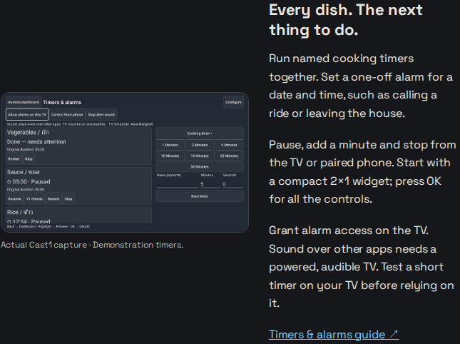
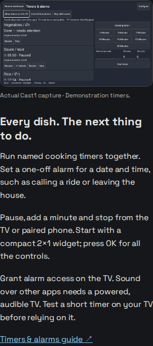

# Timers and household alarms publication verification

Published 19 November 2026 at **[biohack.net/homeboard](https://biohack.net/homeboard/)**.

- Signed public APK: **0.1.92**, package `net.biohack.homeboard`.
- Website commit: [`5e2d8ed`](https://github.com/wbniv/biohack.net/commit/5e2d8ed31288777f2eef48d72978d012152dff2a), tag `v1.0.690`.
- Cloudflare Pages production deployment: [f2acdd61](https://f2acdd61.biohack-net.pages.dev/homeboard/), project `biohack-net`, branch `master`.
- Container website tests, Astro build and internal link check passed. Browser checks at
  1365×1000 and 390×844 passed: images decoded, no horizontal overflow, correct
  version and download link, and no page errors. Actual build previews are below.
- The live custom-domain page returned HTTP 200 and contains version 0.1.92,
  the cooking/event-alarm section and its correct download URL.
- Live APK SHA-256 matches the frozen signed artifact: `462409bdd10c8b141861b17af1e4ac30b61546f1c4210810a1f8b1606a2165de`.
- The live exact-source archive matches `sourceArchiveSha256` in release metadata.
- The live printable manual matches the regenerated two-page A4 PDF byte-for-byte.
- Native timer UI and background audio API acceptance: [device record](2026-11-19-cooking-timers.md).
  Public 0.1.92 installed on Cast2. Cast1's same frozen install was submitted;
  confirmation remained unavailable after wireless debugging and then the
  coordinator control socket became unavailable. No direct transport fallback.

The app and site updates were prepared in isolated checkouts. Unrelated local
Android-widget development and Thai-review page edits were preserved. No host
Android/Java tooling or host application build was used. Cloudflare bundling and
publication also ran in a container with the existing authentication profile.

Final passive evidence collection for Cast1 returned `status: uncertain`,
`health: recovery-required`, `reason: plugin-error`, with no installation receipt
(`J‑edd8bd12e247`). Its public 0.1.92 installation is **unconfirmed**, not a
completed install. Cast2’s independent install and sound result remain verified.
