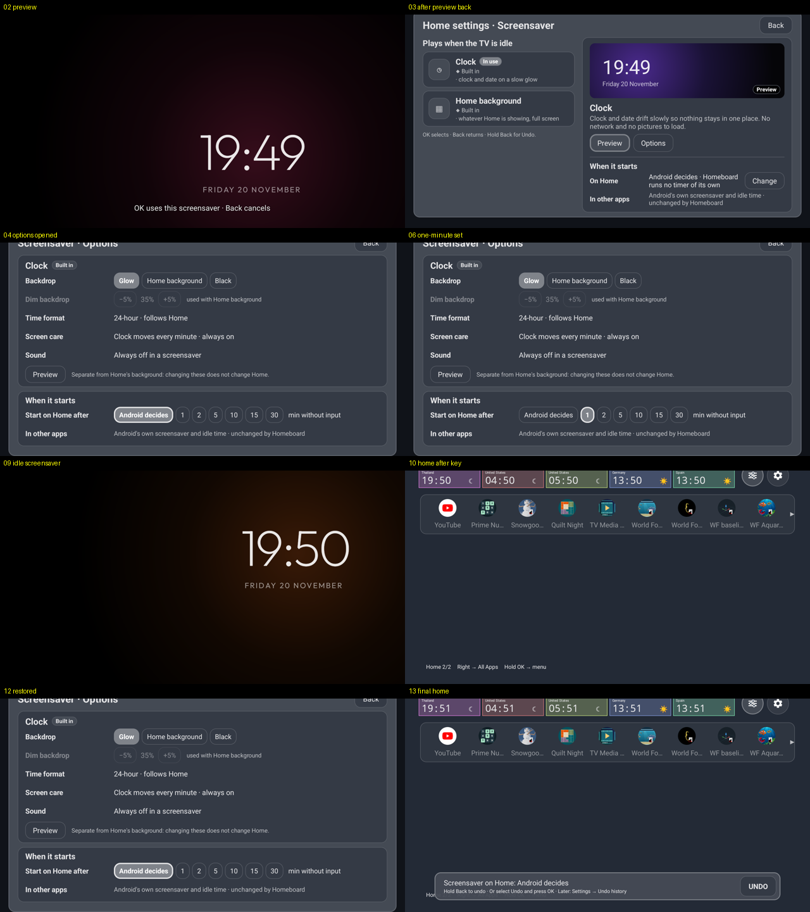

# Screensavers: device test record

## Stage 1 on Cast1, 2026‑11‑20

Build 0.1.102 (includes Stage 1, `e82a088`), `chromecast-test-01`. Recipe
[`dev/device/screensaver-stage1-check.json`](../../dev/device/screensaver-stage1-check.json),
coordinator job `J‑19778f0ac74b`, completed, 30 artifacts verified. The recipe leaves the TV as
it found it: it sets "Start on Home after" to 1 min, then back to "Android decides".



Each frame has a yellow caption added by me for this sheet; the original frames are in the
job's evidence. The captions cover the top 22 px of each frame, so the sheet cannot be used
to judge top-edge clipping. At full size, the Options screen heading and Back button are
fully visible.

| Frame | What it shows |
|---|---|
| 01 | Home settings · Screensaver: Clock "In use", Home background, the sample preview, "When it starts" |
| 02 | Preview: the clock full screen with the hint "OK uses this screensaver · Back cancels" |
| 03 | After Back: the Screensaver screen, Clock still "In use" |
| 04, 06 | Options: Backdrop, Dim, statements, and "Start on Home after" (Android decides, then 1) |
| 09 | The idle screensaver on Home after one minute |
| 10 | Home after a key |
| 12, 13 | Restored to "Android decides"; Home with the Undo banner |

Log lines (`logcat`, tag `HomeboardScreensaver`):

```
19:48:59.719 I HomeboardScreensaver: screensaver started mode=preview entry=clock
19:49:05.669 I HomeboardScreensaver: screensaver stopped mode=preview entry=clock reason=cancel
19:50:24.580 I HomeboardScreensaver: screensaver started mode=idle entry=clock
19:50:34.127 I HomeboardScreensaver: screensaver stopped mode=idle entry=clock reason=key
```

Not yet run: choosing Home background with Use, a choice's Undo, the alarm ending a screensaver
(Verification 7), and "Android decides" starting nothing. Cast2 was in Personal use.

Findings: none against the design. Focus order on the screen is card, then Preview, then Change
(Down), and Back returns to the Home settings pie, as the plan describes.
