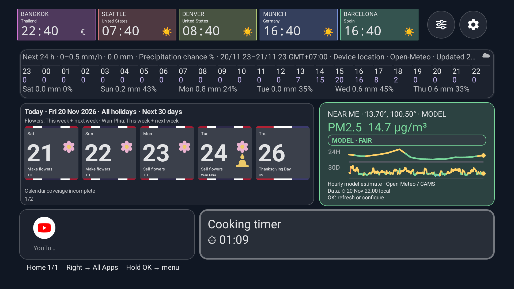
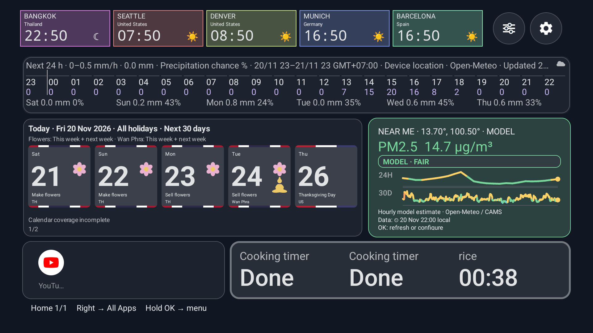
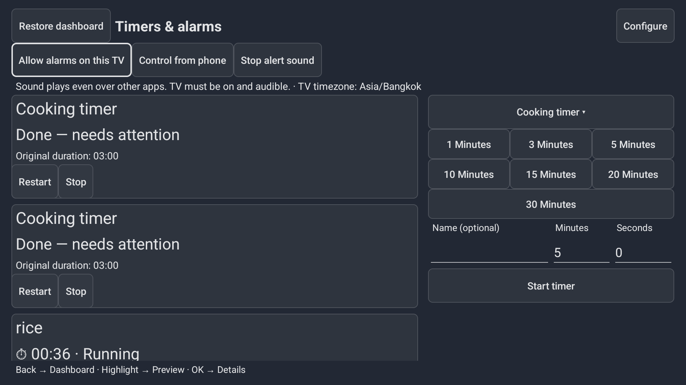

# Timer widget: show simultaneous timers

Will reported two timers running while the wide one-row widget displayed only one.
The 0.1.112 baseline capture `J‑0cfa1d1684f3` confirms one visible timer and no
overflow indicator. The old renderer budgeted items using vertical text lines,
ignoring the available width, and omitted overflow on cards with fewer than three
text lines.

The revised renderer allocates individual timer cells across the available width
and adds rows for taller cards. Each cell has a name and a larger countdown/state.
When not all entries fit, an overflow line is reserved even in a one-row card.
Paused is named explicitly; Done/Missed/Interrupted remain textual states.
Names are ellipsized and values use native text auto-sizing. The existing shared
ticker and timer model are unchanged. See the [design review and mockup](../plans/2026-11-19-cooking-timers.md#november-20-dashboard-display-adjustment).

## Deployment and container checks

`task deploy` built **0.1.113** from `2fd314a` plus the recorded working-tree
changes. Both TVs received the identical frozen APK, SHA-256
`bd872c8ad20f020ae9e4ac083af350d67c4036ce598826bbc63296f8834c332b`.

| Target | Coordinator job | Result |
|---|---|---|
| Cast1 | `J‑ffd9d080305f` | Install and launcher verification succeeded |
| Cast2 | `J‑934715204cbd` | Install and launcher verification succeeded |

Data/settings were preserved by ordinary updates using the durable debug key.
No timer was created, stopped, reset or removed by the acceptance script.
Container checks passed: 644 JVM tests, Android lint, 888 English/Thai resource
checks, 7 calendar tests, 71 cleanup tests and 5 deployment tests.

## Cast1 visual acceptance

Completed job `J‑cc6dfb453f2d`, using
[`timer-widget-display-check.json`](../../dev/device/timer-widget-display-check.json).
Starting state: Home with the timer widget focused. Evidence is under
`docs/diagnostics/timer-widget-after/evidence`, including the three original
frames, input score, capture timestamps, receipt and app logs.

- Dashboard frame: two earlier cooking timers are now Done, and **rice 00:38** is
  running. All three entries are visible in the original card area.
- Short OK opens the richer full-screen timer list, showing the same two Done
  entries and **rice 00:36 · Running**, plus original durations and controls.
- Back restores Home page 1/1, the same widget size and focus. The running timer
  now reads **00:31**, confirming updates continued through the shared ticker.
- The full-screen Restore dashboard action remains visible. This run exercised
  Back, not activation of Restore dashboard.

Limits: this run validates the actual wide shallow card and three existing timers;
it does not establish the full narrow/tall, overflow, empty, long-name, Thai or
Large text matrix. It does not establish audible alarm delivery. Stage 2's
separate Home/All Apps indicator has not been implemented or dispatched here.
