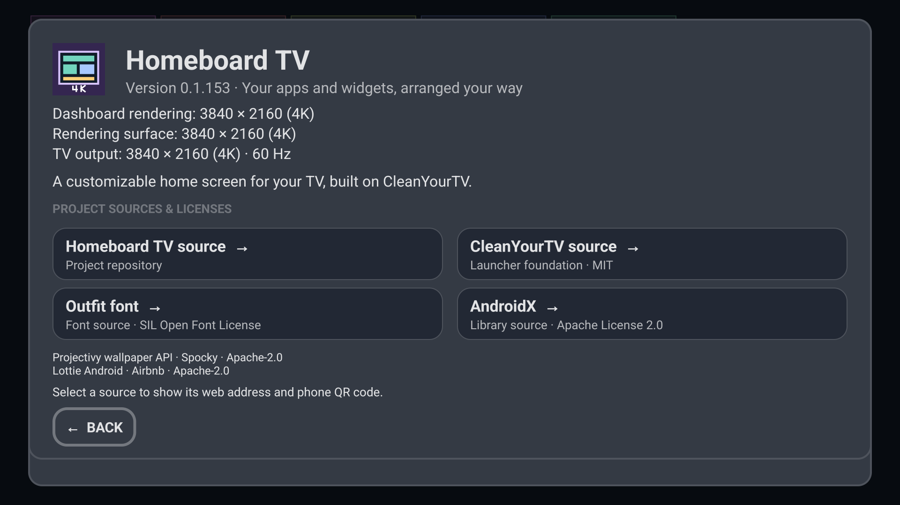
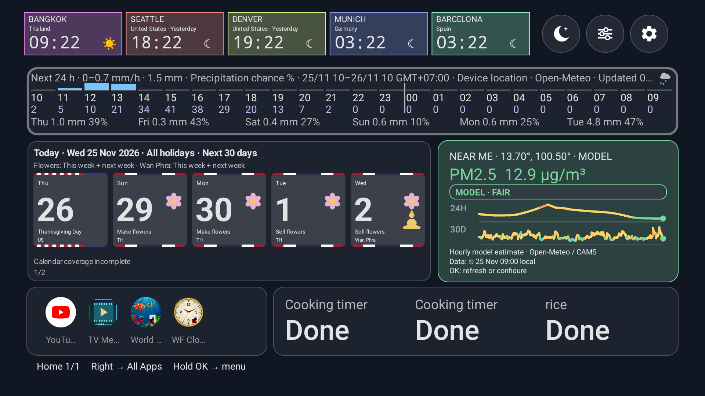

# About rendering resolution and calendar US band · 25 November

About now distinguishes the dashboard's measured root pixels, the proof's
callback-confirmed surface size and the current Display.Mode output/refresh.
Unknown observations remain Unavailable. English and Thai strings are present.
The panel uses actual dashboard bounds and scrolls vertically as needed.
[Plan and mockup](../plans/2026-11-25-rendering-status.md).

## Reviewed About checks

| App / device | Dashboard | Surface | Output | Job |
| --- | --- | --- | --- | --- |
| Ordinary 0.1.152 / Cast1 | 1920×1080 | No separate surface | 1920×1080 · 59.94 Hz | J‑cf790220e508 |
| Ordinary 0.1.152 / Cast2 | 1920×1080 | No separate surface | 3840×2160 (4K) · 60 Hz | J‑028caf34d4f8 |
| Proof 0.1.153 / Cast2 | 3840×2160 (4K) | 3840×2160 (4K) | 3840×2160 (4K) · 60 Hz | J‑4c4cbd1e4456 |

[Ordinary app on the same 4K output](2026-11-25-about-rendering/cast2-ordinary-about.png) ·
[1080p control](2026-11-25-about-rendering/cast1-about.png)

The title, version, measurement rows, source links and Back are readable in the
reviewed captures. Back restores Settings. The earlier scripts' final Back returned
to Settings page 1 rather than Home; the final recipes add another Back for the
existing paged-menu behavior. The first ordinary Cast2 check J‑3a26331d1b3d
opened Calendar detail because its saved focus differed; that run is not About
acceptance. The corrected ordinary recipe opens Settings with Menu directly.
The proof recipe starts from its explicit Rain acceptance alias; Menu exits the
proof and is therefore not used to open its Settings.

## Build checks

Container task check passed: 685 Java tests, including three independent-resolution
and unknown-size tests, calendar pipeline, cleanup/deployment tests and Android
lint. Proof lint and packaging passed for 0.1.153. The combined calendar correction
passed task check again before ordinary 0.1.154 packaging. An initial concurrent
proof Gradle run timed out on the shared cache lock; the sequential rerun passed.

## Calendar marker

The US calendar band now has thirteen equal-width vertical stripes across its
left two-thirds: seven red and six white, red at both edges. Its right third is
solid blue. The existing band height and calendar content/navigation are unchanged.
[Design reference](../plans/2026-11-25-calendar-us-band.svg).

## Deployment

Ordinary Homeboard 0.1.154 is frozen under artifacts/deployments/0.1.154/:
SHA-256 `f80ca4fae141e90fa4a71640faa0d6b540bb5b463f87274fc664d2effdcd1e6b`.
Cast1 J‑c5b519e5da9e and Cast2 J‑8104786a3227 completed installation/launcher
verification. Pixel J‑9738c0e3cc47 installed but its launch continuation reported
device-locked; installation and foreground acceptance are separate results.
Tablet J‑5f2eb9568a87 is queued while unreachable. The superseded tablet 152
job was cancelled by its owner.

Proof 0.1.153 installed on both TVs and Pixel, with exact sources and hash receipts
under artifacts/native-dashboard/0.1.153/. Its TV launcher-artwork continuations
reported the existing plugin-error and automatic recovery restored ready health;
the independent native About check above then passed. Pixel's continuation was
blocked by the lock screen. The 155 extended script returned Home but could not reach a source link: forwarded
Up keys left focus on Back. The final proof adds explicit focus search for
unconsumed D-pad keys inside the embedded hierarchy; app/widget handlers keep
priority. Final combined deployment and captures are recorded below. No FPS work was performed; another agent owns it.

The first 154/155 flag candidate used horizontal lines in a seven-unit band;
they blended into pink in the reviewed capture. That candidate failed visual
acceptance. The final correction uses thirteen equal-width vertical stripes
across the left two-thirds, with solid blue on the right.

## Final ordinary deployment and stripe acceptance

Ordinary 0.1.156 is installed on both TVs and Pixel. Its SHA-256 is
`15db6108575ff674115169f7cbee9cfe340bffdc70f5c69f34a68cde816069fd`.
Cast1 J‑c6dd3984523e and Cast2 J‑5567b68402e2 passed installation/launcher
verification. Pixel J‑02499f9a0b48 verified installation; its launch continuation
was blocked by device-locked. Tablet J‑97dc06bd9805 remains queued while unreachable.

Cast1 check J‑fd18fc57d3a6 passed with reviewed About/Settings/Home captures.
The final US marker visibly has thirteen equal-width alternating segments on the
left and solid blue on the right. Country text and the rest of the calendar are
preserved. The small drawing change needs no extra mirrored unit test.

The proof's source/QR panel now also uses the measured dashboard viewport width,
so it can show its existing two-column content on the embedded display. Final
proof 0.1.157 includes this bounds fix, the unhandled-key focus correction and
vertical US stripes. Its frozen APK/source record is under
artifacts/native-dashboard/0.1.157/, SHA-256
`fa2249c16db6512997877fd082790cc02e8a449e3c23c90e2cc569c41ff068e0`.

## Final proof installation and commit-source validation

Final 0.1.157 install-stage receipts verify the frozen hash on Cast2
(J‑24e4c579e397), Cast1 (J‑d8733e52f58c) and Pixel (J‑cc9ac83b18b9).
The TV launcher-artwork continuation still reports plugin-error; automatic readd
J‑ae3f31d7c5f5 / J‑79f118b20cf4 verified recovery. Pixel's continuation reports
device-locked. Those continuation results do not replace the verified install
hashes. Tablet J‑163870dd5797 remains queued while unreachable.

The exact staged source was exported without the unrelated Trello edits. Its
671 Java tests and proof assembly passed in the container after the final changes.
Ordinary/proof lint passed; the full working tree's task check passed 685 tests.
Source archives/hashes distinguish the deployed working-tree build from the
commit without the unrelated development work. No FPS measurement is included.

The final 157 scripted job J‑98fc14714324 completed but began in restored
Calendar state, so its captures do not establish About/source-link acceptance.
The earlier native About capture above remains the verified measurement display.
An adaptive follow-up J‑b445019deb4f was stopped with coordinator cleanup when
Will requested observing the live PM2.5 map instead. Source-link navigation in
157 remains unverified; no successful script is inferred from a completed job.

## Separate observed map issue

At Will's request, passive Cast2 capture J‑2ad5b85aa1e6 shows missing rectangular
map tiles while station markers remain. Passive recording J‑ec597d3d1c7a retains
the live behavior without navigation. StationMapView's fixed 40-tile LRU cannot
retain a full native 4K viewport, and its duplicate-request guard removes an
already-pending key. These are likely causes of repeated loading/eviction. They
are recorded as a separate pending map correction, not part of the About/flag fix.
