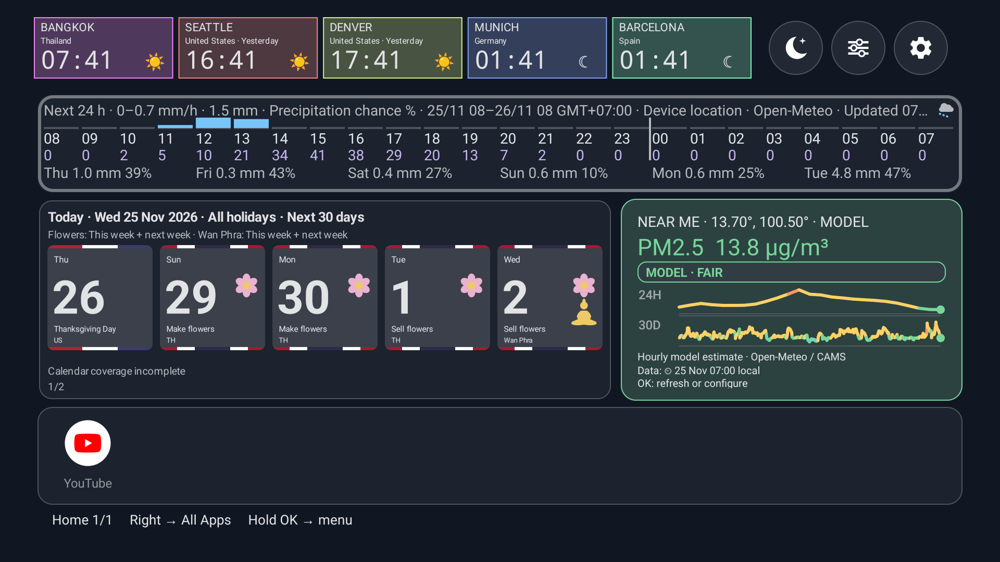
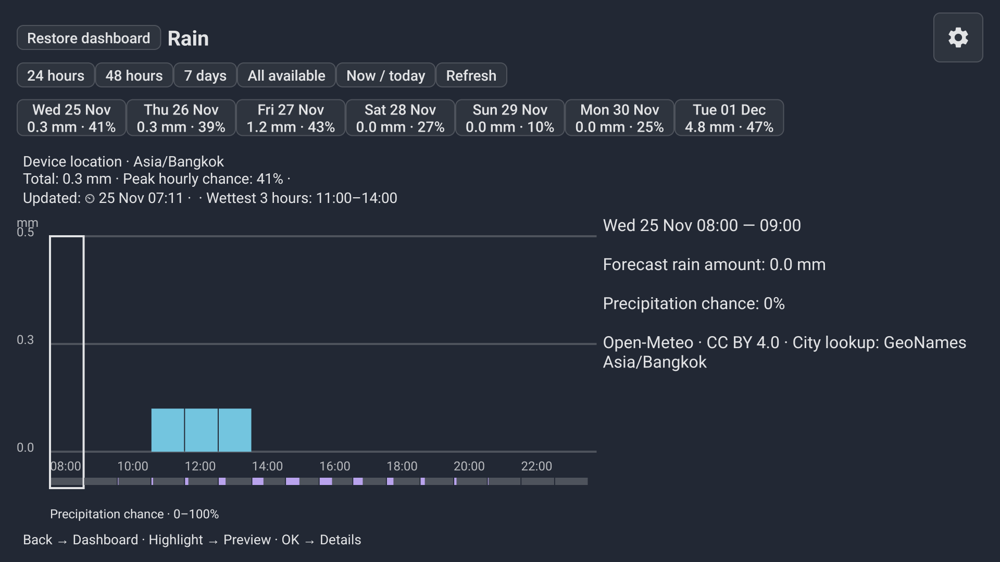
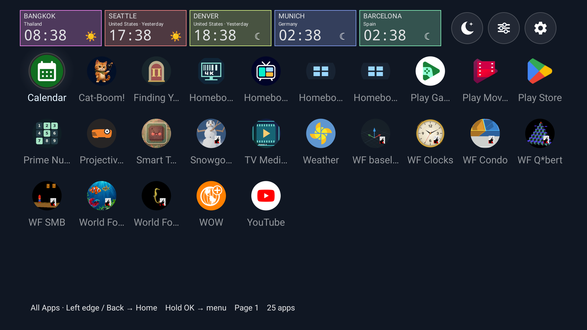

# Native 4K dashboard proof on 25 November

**26 November production follow-up:** native embedding is now automatic in the
ordinary launcher on supported UHD TVs. See the
[production rollout and recovery checks](2026-11-26-automatic-4k.md). The original
proof results and performance limitations below remain historical evidence;
performance measurements are not a deployment gate under Will's updated direction.

**A real interactive dashboard hierarchy now renders at 3840 × 2160.** It runs in
an independent engineering app using the production Java sources and resources.
The normal Homeboard launcher has not switched to native rendering. This record
closes specific proof checks, not the complete native 4K plan.

## Rendering and interaction

Cast2 check `J‑e6df4ec55563`, proof 0.1.147, records:

```text
output=3840x2160 density=640
dashboard=3840x2160 surface=3840x2160 hardware=true
```

Reviewed script captures show Rain expansion at the expected size, Back restoring
Home with Rain focused, Right opening All Apps and Back restoring Home. The
separate Restore check `J‑5a67eeaaf7d2` reaches the visible Restore dashboard
control and returns to Home. Clock check `J‑4e2a923e15ed` opens the actual World
clock detail and restores the originating toolbar focus.

| Check | Result |
| --- | --- |
| Actual dashboard and rendering surface at 3840 × 2160 | Passed in app measurements on Cast2. |
| Home and All Apps | Navigation passed, but All Apps formatting failed: the embedded capture shows only four columns and one row instead of the dense grid. Earlier visual acceptance was incorrect; see the regression investigation below. |
| Rain full screen and Back | Passed; layout and Rain focus restored. |
| Visible Restore dashboard | Passed from the explicit acceptance starting state. |
| World clock full screen and Back | Passed with reviewed capture. |
| Native menus | Rendered and navigated; not every menu/editor is accepted. |
| 1080p control | Cast1 `J‑5438761fec0a` passed the same Rain/Back/All Apps script, with `dashboard=1920x1080 surface=1920x1080 hardware=true`, density 320. |
| Background process recovery | Cast2 `J‑6e71ddde8b56` killed PID 21224 and cold-started PID 21386; the actual 4K dashboard returned. Cold start was 4407 ms. No persistent settings changed. This is not exhaustive mode/allocation recovery acceptance. |
| Physical panel pixel detail | Still requires independent output/panel evidence; these captures are 1920 × 1080. The LG itself is already known to be 4K. |
| Complete production 4K launcher | Not enabled or accepted. |





[All Apps](2026-11-25-native-4k-dashboard/all-apps.png) ·
[Restore action result](2026-11-25-native-4k-dashboard/restore-action-home.png) ·
[World clock](2026-11-25-native-4k-dashboard/world-clock.png)

The captures are coordinator screenshots, not physical panel photographs or
native 4K pixel-detail captures. Weather/air data came from the app's normal public
sources; the isolated proof has its own settings and does not copy household
credentials or Homeboard preferences.

## Implemented candidates

The separate `:dashboard-proof` app has package
`net.biohack.homeboard.dashboardproof` and label Homeboard 4K Dashboard Test.
It declares no Home intent and no boot receiver filters. Menu exits the proof.
Regular icon launches retain navigation. Explicit acceptance aliases establish
Home/Rain focus on a fresh run, without changing layout or fabricating data.

- Launching a full Activity on a private display failed Cast2's platform check:
  secondary-display activities are unsupported. Check `J‑006702fa735c`, 0.1.142,
  is a completed session containing a failed rendering candidate.
- A native Presentation then hosted the real MainActivity hierarchy successfully.
  The initial expanded Dialog used the physical window and was oversized. Giving
  dialogs the presentation context/type fixed their geometry; explicitly handling
  unconsumed directional keys fixed forwarded-window focus navigation.
- The direct SurfaceControlViewHost comparison also renders the full hierarchy at
  native dimensions. It embeds through SurfaceView's surface-package API, which
  provides the platform accessibility linkage. Its widget/editor dialogs use an
  overlay plane inside the embedded hierarchy. The normal app continues to use
  ordinary Dialog windows through the same shared classes.

The direct embedding API requires Android 11 or newer for this diagnostic module;
Homeboard's normal platform support is unchanged. API linkage is not screen-reader
acceptance. Both candidates and their lifecycle/input limitations remain described
in the [plan](../plans/2026-11-23-native-4k-dashboard.md).

## Build verification and deployment

Container `task check` passed, including 682 Java tests and Android lint. Later
shared window/dialog changes passed `:app:testDebugUnitTest`, `:app:lintDebug`,
`:dashboard-proof:lintDebug` and `:dashboard-proof:assembleDebug`. The normal
unsigned `task bundle` also passed. These results do not establish runtime
acceptance for every normal-window path.

Frozen 0.1.147 APK SHA-256:
`dc0760f41eb14ff61b2307f50f6d70e500c8732722db19624acb30e994a92053`.
Exact source archives and per-file hashes are retained under
`artifacts/native-dashboard/<version>/`. Installation and launcher verification
are separate outcomes: some proof install continuations could not verify a tile,
while their install-stage receipts verified the APK hash. Physical UI checks above
are separate admitted jobs.

Raw 147 evidence is retained locally under:

- `docs/diagnostics/2026-11-25-native-dashboard-147-navigation/`
- `docs/diagnostics/2026-11-25-native-dashboard-147-restore/`
- `docs/diagnostics/2026-11-25-native-dashboard-147-menu-clock/`
- `docs/diagnostics/2026-11-25-native-dashboard-147-cast1/`

Earlier 0.1.141 ordinary Homeboard installed and passed coordinator verification
on both TVs; Pixel verification failed `target-left-foreground`, and its tablet
install remained queued while unreachable. The later proof APK is a different
package and does not replace those household settings. Only this session's
superseded queued proof installs were cancelled; other owners' work was preserved.

## Performance findings

| Sample on Cast2 | New HWUI rows | Median completion | p95 completion | Interpretation |
| --- | ---: | ---: | ---: | --- |
| Normal debug Homeboard, `J‑707db77dbf21` | 120 | 84.57 ms | 104.96 ms | All sampled rows missed their recorded deadlines. |
| 4K Presentation, `J‑50df18c05376` | 119 | 105.56 ms | 111.89 ms | All sampled rows missed their recorded deadlines. |
| Direct embedding, `J‑8fb07138de07` | 0 exposed windowless rows | Unmeasured | Unmeasured | The collector's registered-window rows omit the embedded root. Process aggregate statistics still show slow frames; no improvement is claimed. |

These runs include collector overhead and different saved app state; they do not
isolate causality or measure physical input latency. Native PSS samples were
roughly 80 MiB; compositor buffers are not fully attributed by package PSS. A
rendering trace attempt `J‑0ab1dfb41ab4` timed out in the coordinator, whose automatic
recovery `J‑3fd888306fed` completed. It supplies no successful trace result.

## Remaining acceptance before automatic integration

Finish controlled performance attribution and pixel delivery; exercise all widget
expansions and editors, live Android app widgets, TextureView/video and wallpaper;
verify screen readers, larger text and Thai; test external-app return, output
changes, surface loss, memory pressure and saved navigation recovery. Then choose
and integrate the renderer with automatic selection, bounded resource use and
ordinary-renderer fallback. The provider-image 1080p target has not been lifted.


## Final proof package

**0.1.149** is installed on Cast1, Cast2 and the Pixel, with install-stage hash
verification. SHA-256:
`886eba9bf8f420f2d23048d8aee7de678c1835cb5170dae2a826b3455c0c9d89`.
The Java source hashes match the accepted 0.1.147 sources; 148–149 change the
launcher entry and add the distinct purple dashboard-grid icon/banner. Opening
Homeboard 4K Dashboard Test selects the direct embedded candidate.

Install jobs: Cast2 `J‑00a4246a6a51`, Cast1 `J‑00b219bc331e`, Pixel
`J‑65506b7217eb`. The two TV launcher-verification continuations failed in the
coordinator at `plugins/android/launcher.py:143:apk_references` with `plugin-error`;
their automatic recovery jobs completed with health ready. This does not undo
the separately verified installs or count as launcher-artwork acceptance. Pixel
launch acceptance remains separate. Tablet `J‑73eed4dcd632` remains queued while
unreachable. No battery hold was overridden because these jobs were not held
for battery. Evidence is under `artifacts/native-dashboard/0.1.149/`.

Final installed-APK check `J‑85028cf6e467` completed successfully on Cast2 and again
reported the actual hierarchy and surface at 3840 × 2160 with hardware
acceleration. Its evidence is retained locally at
`docs/diagnostics/2026-11-25-native-dashboard-149-final/`. The launcher-plugin
failure above is separate from this successful app rendering check.

## All Apps formatting correction · 0.1.151

Will correctly reported the embedded All Apps formatting regression. The earlier
147 capture showed only four icons in one centered row; navigation succeeded, but
calling its formatting accepted was incorrect. That failed capture is retained
above. Diagnostic 150, `J‑63a44501b6ca`, confirmed:

```text
metrics: width=1920 height=1080 density=4
root=3840x2160 labelDp=22 grid=4x1
```

Android had updated the embedded context's resource dimensions to the physical
Activity's logical window while retaining native density. MainActivity now fits
Home/All Apps grids to the measured dashboard root when available, using resource
dimensions only before layout. No icon/banner preferences or app order changed.
Debug grid logs retain the dimensions and computed grid for regression diagnosis.

**Corrected formatting passed with reviewed captures:**

| Device and job | Measured hierarchy | Calculated grid | Observed interaction |
| --- | --- | --- | --- |
| Cast2 `J‑8eac54d92d42` | 3840×2160, density 4 | 10 columns × 4 rows | 25 apps occupy three rows; Down and Right move focus to row 2 / column 2; Back restores Home with Rain focused. |
| Cast1 `J‑eb39682aa1cf` | 1920×1080, density 2 | 10 columns × 4 rows | 36 apps occupy four rows; Down and Right move focus to row 2 / column 2; Back restores Home with Rain focused. |



[1080p control](2026-11-25-native-4k-dashboard/all-apps-151-cast1.png) ·
[Second-row focus on Cast2](2026-11-25-native-4k-dashboard/all-apps-151-focus.png)

`task check` passed in containers, as did `:dashboard-proof:lintDebug` and
`:dashboard-proof:assembleDebug`. The complete regression recipe is
`dev/device/native-4k-dashboard-all-apps.json`, starting via the embedded acceptance
alias. These captures verify the existing small-icon layout; banner, large-text
and accessibility acceptance remain separate.

Frozen 0.1.151 SHA-256:
`088cb91bbbaae17f4788f01ecaaad4a7201fb16770ecb099b1a280dbc19d01e9`.
Source archive/hashes and verified installation receipts are under
`artifacts/native-dashboard/0.1.151/`. Install jobs: Cast2 `J‑2353fa9ede35`,
Cast1 `J‑6f34d9960280`, Pixel `J‑dab2f5d59d30`. Both TV install-stage hashes
verified; their subsequent launcher-artwork checks again failed `plugin-error`.
Automatic recoveries `J‑caa8b17bab30` / `J‑bbce2c5626f9` completed with health ready,
and the independent regression checks above passed. Pixel's install job completed.
Tablet replacement install `J‑1e4e32a6f36e` remains queued while unreachable; only
this session's superseded 149 tablet proof job was cancelled. Ordinary Homeboard
and other queued work were preserved.

Before committing, the staged 4K sources were exported to an isolated temporary
checkout without the unrelated Trello changes. Container `:app:testDebugUnitTest`
passed 668 tests, and `:app:lintDebug`, `:dashboard-proof:lintDebug` and
`:dashboard-proof:assembleDebug` passed. This validates the commit independently;
the frozen device-test archives above remain the exact deployed source records.
