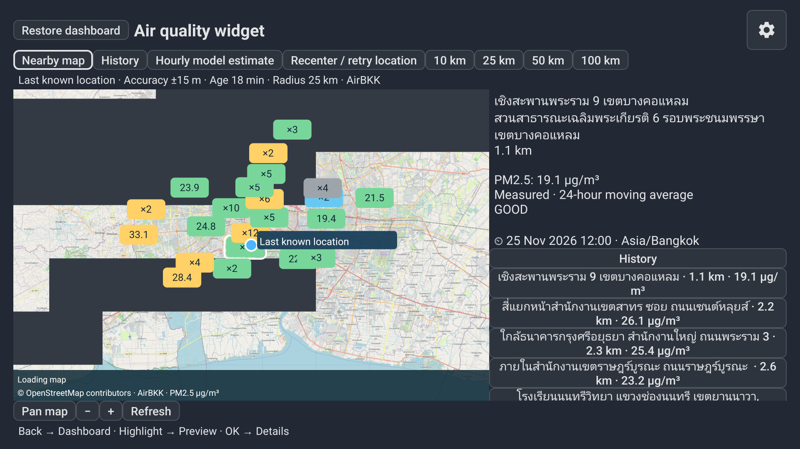
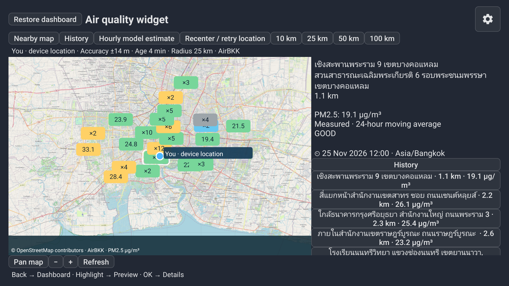

# PM2.5 map tile stability · 25 November

**Fixed and verified on Cast2's native 4K dashboard.** The map no longer loses
loaded rectangles as visible tiles evict one another. Cast1's ordinary renderer
also passes the map/control restoration check.

## Cause and change

The original StationMapView held 40 tiles, fewer than a complete 4K map viewport.
Loading another visible tile could evict an already-visible tile; each completion
invalidated the view and started another pass of missing-tile loads. Its request
guard also removed an existing pending key when encountering it again, permitting
duplicate work.

MapTileCache pins every visible tile and evicts only offscreen history. Capacity
is the greater of the visible set and 40 recent tiles. Request admission remains
limited to 32 outstanding tasks and two workers; duplicate attempts leave existing
requests intact. Queued obsolete work is skipped, late results are ignored, and
failed refreshes retain usable cached tiles. Drawing uses an explicit 256-pixel
rectangle to keep bitmap density from changing the projection's tile pitch.
The map's controls, saved layout and source/location settings are unchanged.
[Design/implementation record](../plans/2026-11-17-widget-full-screen.md#pm25-map-tile-stability--25-november).

## Regression and device verification

Container task check passed **691 Java tests**, including six new tests for a
native viewport larger than 40 tiles, repeated redraws, duplicate requests and
request limits, obsolete completions, bounded offscreen history, failed-refresh /
close behavior and wrapped/clipped tile coordinates. Android lint and ordinary
APK packaging passed. Proof lint and packaging passed separately.

| Check | Evidence and result |
| --- | --- |
| Before fix, live Cast2 | Passive capture J‑2ad5b85aa1e6 and recording J‑ec597d3d1c7a show missing map rectangles with station markers present. |
| Cast1 control, ordinary 0.1.158 | J‑25d475c1cc9d: complete map in successive captures, Back restores Home with air widget focus. Session finished and cleanup completed, health ready. |
| Cast2 native 0.1.159 | J‑52a88dc35537: initial partial loading progresses to a complete map; later station-selection redraws retain the complete map. Zoom loads a new viewport; a subsequent panned capture is complete. |
| Native cleanup | The 240-second native session reached its limit after the zoom/pan capture; cleanup completed with health ready. Later attempted reset inputs were rejected and had no device effect. Native final pan/zoom reset and Back are not claimed from that session; Back/restoration is verified by the control check. |

[Complete map after zoom and pan](2026-11-25-pm25-map-stability/pan-cast2.png) ·
[1080p control](2026-11-25-pm25-map-stability/cast1-control.png)

The captures are logical coordinator screenshots, not physical 4K panel-detail
proof. Initial loading after a viewport change is expected; the regression is
loaded pieces repeatedly disappearing from the unchanged viewport. Raw owned
session evidence is retained locally at docs/diagnostics/2026-11-25-map-control-158/
and docs/diagnostics/2026-11-25-map-native-159/.

## Deployment

Ordinary Homeboard **0.1.158** was built/frozen by task deploy. APK SHA-256:
`3f193279f2ce47f6ed6f14ff895447359341542a7917e833be2a7ce67c021048`.
Cast1 J‑5d77144f325b and Cast2 J‑42de4db75e2f completed install/launcher verification.
Pixel J‑cc88e174c1c5 installed; its launch continuation reported device-locked.
Tablet J‑888851836f86 remains queued while unreachable.

The separate 4K Dashboard Test **0.1.159** has frozen exact sources and install
receipts under artifacts/native-dashboard/0.1.159/. APK SHA-256:
`5c66d28896b69205019bac32298a5292dbc2de0e72d76f8ff25089fa1143be7b`.
Install-stage hashes verified on Cast2 J‑89b5cfd2c2e4, Cast1 J‑b1a5af631677 and
Pixel J‑4ec9b9035f95. TV launcher-artwork continuations encountered the existing
plugin-error, followed by verified automatic recoveries J‑05e961dffde5 and
J‑58b70bbe7b18. Pixel's continuation was device-locked. The separate admitted
native interactive check above verified the running map. Tablet J‑c171ce1b9f72
remains queued; only this session's superseded tablet jobs were cancelled.

### Follow-up deployment: 0.1.160 and network change

The requested follow-up used `task deploy` for Cast1, Cast2, Pixel and the tablet.
Container tests, lint and APK assembly passed. Ordinary Homeboard 0.1.160 is frozen
under `artifacts/deployments/0.1.160/`, SHA-256
`3464e9c49b2fa8203a721daa125261f8a82333058119043ca77684cfbaec0f5b`.
Saved install receipts verify that identical installed hash on Cast1
J‑df455c9011cd, Cast2 J‑c8656ab12eb2 and Pixel J‑199d2b7745d6. Cast2's complete
job succeeded; Cast1 and Pixel ended uncertain/recovery-required during subsequent
verification or cleanup. Their verified install stages do not establish successful
foreground acceptance or cleanup. Tablet J‑924583761343 remains queued while
unreachable; its older ordinary J‑888851836f86 was cancelled after replacement
submission.

The matching 4K Dashboard Test 0.1.160 passed container lint/assembly and is frozen
under `artifacts/native-dashboard/0.1.160/`, SHA-256
`d2722da7bb67bf6418a2ca335ce02fa1d4adcad7f7da5b9866ff5d96d5bd3531`.
It has **not been submitted or installed**. The last verified native test app on
the reachable fleet remains 0.1.159. Its tablet installation J‑c171ce1b9f72 remains
queued.

Will reported that this workstation is now on a different network from the
Chromecasts. Stop live verification and further device submissions here. Resume
through the coordinator when connectivity is available; inspect existing jobs
and recovery status before submitting replacements. Preserve the frozen artifacts
and current app data. No direct-device fallback or network-setting change was made.
