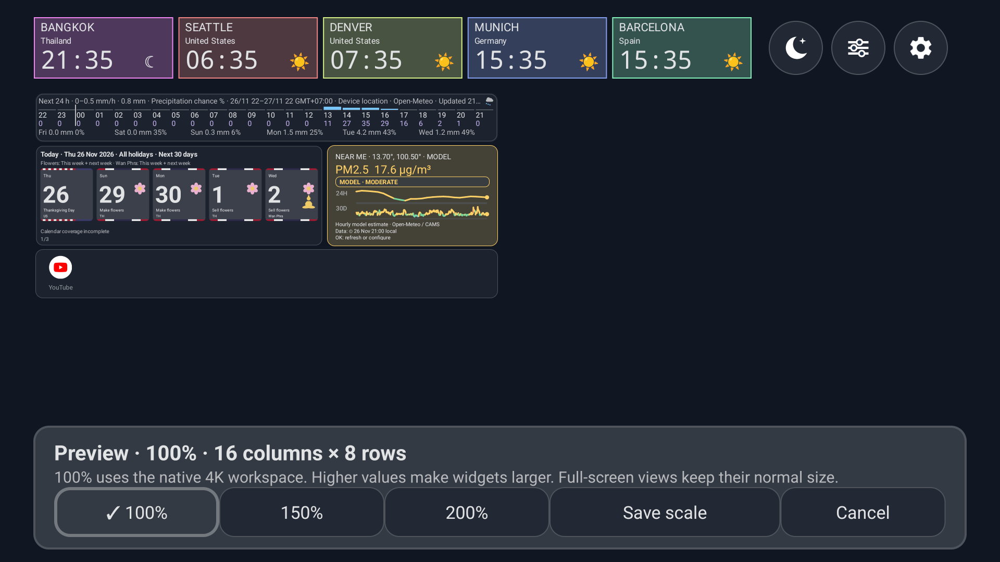
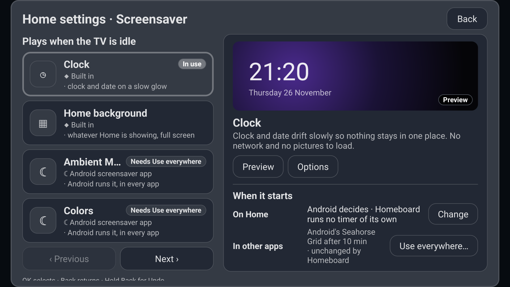
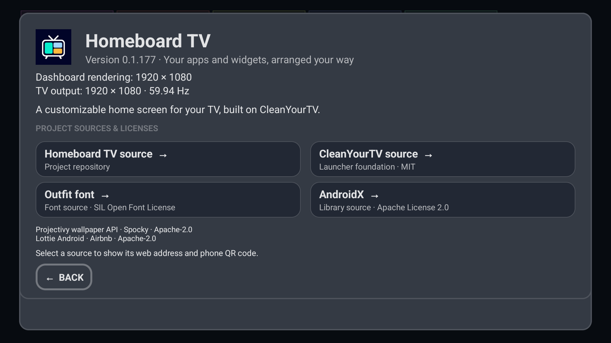
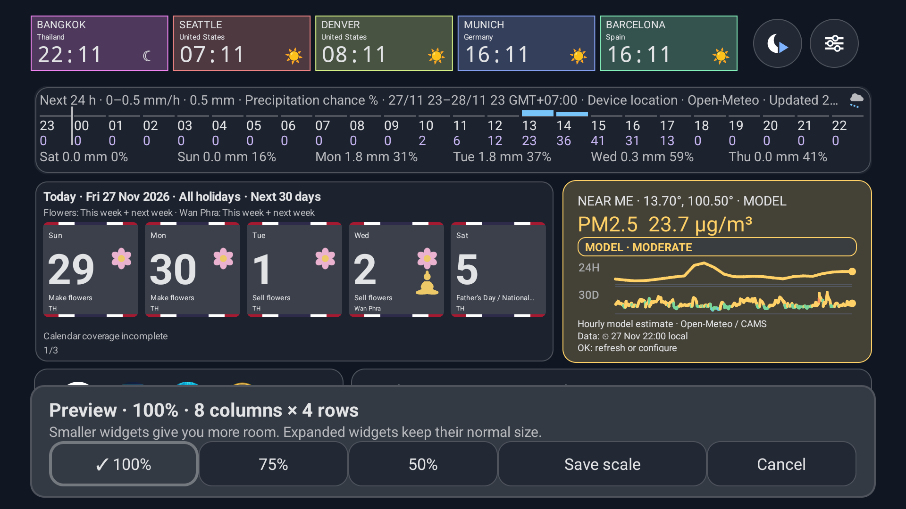

# Automatic native 4K in ordinary Homeboard · 26 November

Automatic native 4K and the native 100% baseline are implemented and deployed;
extended acceptance and the offline tablet install remain open. Will authorized production integration and clarified that
performance metrics are informative, not a prerequisite for going 4K.

## Implementation

The existing MainActivity now derives from NativeDashboardActivity. On Android
11+ TVs with active UHD output and a lower-resolution ordinary UI, it hosts the
same production hierarchy in a bounded 3840×2160 SurfaceControlViewHost. Already
native UHD UI, HD outputs and phones keep their ordinary rendering path. No HDMI
preference, system density, default Home selection or saved layout is changed.

NativeDashboardHost retains the existing proportional density and input/modal
handling proven by the separate engineering package. Surface destruction releases
the view host; surface return attaches the retained hierarchy again. Output-size
changes recreate using MainActivity's saved navigation. Font/density/orientation
configuration changes rebuild resources. Allocation, attachment or initial surface
timeout failure recreates with ordinary rendering; a process-local failure latch
prevents a repeated native allocation loop. New process startup can try again.
Embedded dialogs hide the underlying dashboard from accessibility traversal while
open and restore its previous accessibility flags on dismissal, including nested
modal planes. This is implementation behavior, not a claim of TalkBack acceptance.

Workspace scale remains independent and preserves the ordinary package's saved
value. The separate proof package's 50% layout is not copied into the ordinary
package. Wallpaper image decode limits remain bounded at their existing 1080p
target; native UI rendering is not a claim of higher-resolution wallpaper/video.

**Native percentage baseline, corrected by Will:** on a UHD-capable TV, the full
16×8 workspace is now labelled **100%**, with 150% and 200% for larger widgets.
Fresh UHD layouts start at that native 100%. Existing saved sizes/placements
remain unchanged; the renderer-unit storage does not change. The baseline uses
advertised UHD capability so a temporary HD output or ordinary-renderer fallback
does not relabel the same TV's choice. HD-only devices retain their native 100%.
The label/default correction shipped in **0.1.170**. Cast2 acceptance
J‑c19f49cc47b7 verified the frozen APK hash, native 3840×2160 hierarchy/surface,
and the actual scale preview: **100% · 16 columns × 8 rows**, with 150% and 200%
choices. Back cancelled the draft. The saved ordinary-app layout already used
this workspace following the 0.1.168 scale save; relabelling did not move widgets.

## Current deployment and checks

Frozen 0.1.170 SHA-256:
`b5230b6658a34102532b992708cc30e35c74bb7a141180ac8396eb5e8348afdc`.
Cast1 J‑c875705e8ebd installed and verified this artifact. Pixel
J‑a3f5ca664ba5 verified installation but its foreground continuation encountered
a transport deadline; subsequent automatic recovery completed and the device
returned ready. Do not count that whole job as a passing UI check. Cast2's
background install J‑13353e47f88f was refused because the package was foreground;
the subsequent authorized foreground acceptance J‑c19f49cc47b7 installed the
identical artifact and completed healthy. Tablet J‑44176022e431 remains queued
while unreachable. Our older ordinary-app tablet installs were cancelled as
superseded; their historical receipts below are not current queued installs.

The isolated staged production source passed **704 JVM tests and Android lint**
in containers. The deployed working tree, including concurrent Trello work,
passed 718 tests and lint. The isolated engineering package also passed Java
compilation and lint. These checks do not depend on the uncommitted Trello files.
The corrected chooser bounds were visually verified on 0.1.168:

Additional checks retain explicit limits: the later Cast1 HD acceptance
J‑1787c2930c16 was refused as a version downgrade after another deployment;
it did not exercise 0.1.170. Provider review J‑e3347659551f opened MainActivity
instead of the intended isolated probe, so no provider or household layout
changes were made and the session was finished healthy. This is not another
provider pass. Live HDMI output transitions, screen-reader checks, independent
panel pixel detail and broader real-provider compatibility remain open. Earlier
fixture and HD evidence remain in their dated records. The ordinary MainActivity
catalog entry was restored; no temporary provider catalog entry remains.

## Closing round · 27 November

**Extra HD acceptance, rerun: PASS.** Cast1 on deployed 0.1.177
(SHA‑256 `6216656b…ef32`). The scripted check `J‑99927171f81c` completed
healthy and restored the dashboard, but its About step opened the Home button
panel: the settings menu now has three pages, so
`dev/device/about-rendering-check.json` is stale. The owned Remote
`J‑f487348f74e2` (22:09–22:13) read About directly: **Version 0.1.177,
Dashboard rendering 1920 × 1080, TV output 1920 × 1080 · 59.94 Hz**, with no
native surface line. The Dashboard scale preview shows the HD baseline,
**100% · 8 columns × 4 rows**, with 75% and 50%. Cancel left the saved scale
unchanged. Opening Configure from phone by mistake started phone editing, and
it was stopped straight away. The session ended `health: ready`.

**Isolated provider probe: fixed, waiting on Cast2.** The probe looked for widget
text in the activity window. Under native rendering that window holds only the
SurfaceView, so on Cast2 the probe would have failed whatever the dashboard did.
Commit 51e8181 points it at the embedded root and adds the renderer to its
report. The 26 November session `J‑e3347659551f` opened MainActivity, because the
catalog entry still named MainActivity. A rerun has to register the probe
activity first and restore MainActivity afterwards.

**Live output transitions: probe built, waiting on Cast2.**
`NativeOutputTransitionProbeActivity` (51e8181, in 0.1.179) switches UHD → HD → UHD
through its own window's display-mode preference and checks the renderer, the UHD
baseline, the layout, the page and focus at each stage. Recipe:
`dev/device/automatic-4k-output-transition.json`, validated against Cast2's profile
with no job created.

**Moved out of this item:** independent panel detail (needs Will's eyes at the
LG), screen reader (the coordinator has no TalkBack enablement), external phone
transport (not specific to 4K) and broader real providers (open-ended). See the
[plan's closing round](../plans/2026-11-23-native-4k-dashboard.md#closing-round--27-november).

Evidence: `docs/diagnostics/2026-11-27-auto4k-hd-177/` and
`docs/diagnostics/2026-11-27-auto4k-hd-177-remote/`.

## Initial 0.1.165 verification · historical deployment state

Ordinary **0.1.165** was frozen by the concurrent screensaver deployment. Its
source manifest matches every automatic-4K implementation file and fallback
probe exactly, so the identical APK was reused for the remaining fleet targets.
SHA-256: `bb48861e8ae2ef754e46dc66b50e6902b19f0258b9a2747164e1ab647bc9f1c9`.
Cast1 install is J‑8ae05e7befd0; Cast2 J‑81410cb0064a completed healthy with the
installed hash verified. Pixel J‑42daea0739fd failed its foreground continuation
after installation; tablet J‑6f40ba04d58c was initially queued offline
and was subsequently cancelled as superseded. Extra-target receipts
are recorded separately in the frozen artifact directory to preserve the other
deployment owner's manifest.

Cast2, LG UHD output:

- Larger device text at 1.3×, J‑82f7bd321fcc: applied capture shows a usable Home
  layout, including responsive clock overflow and compact Rain content. Logcat
  reports `dashboard=3840x2160 surface=3840x2160 hardware=true`. The original font
  setting was unset; the diagnostic restored that exact unset value. This is not
  screen-reader acceptance.
- Fresh-launch check J‑422b52a419f4 shows the actual normal dashboard and focus
  movement. Remote J‑79ad15977aa3 confirms normal-app About **0.1.165**, dashboard
  **3840×2160**, surface **3840×2160** and output **3840×2160 at 60 Hz**.
- Reviewed All Apps retains the dense ten-column grid; Rain expands at normal
  size and Back restores Home. Leaving for Android settings and Back restores
  the actual Home hierarchy. No Android settings were changed in that round trip.
- A black capture after the font diagnostic was initially suspected to be a
  native return failure. Its cleanup commands show Homeboard was force-stopped
  and YouTube restored instead. It is not evidence of a Homeboard surface defect.
- Injected attachment failure, J‑2feb5a800650: actual Activity recreation fell
  back from native 3840×2160 to ordinary 1920×1080. The machine report explicitly
  passed with `layoutUnchanged: true`. This tests the real failure/recreation path,
  not an actual hardware OOM. The normal MainActivity catalog entry was restored.
- Actual background kill, J‑c61f6e848a77: PID 31638 was killed and cold-started as
  PID 31790 in 4733 ms. Its restored normal app reported a native 3840×2160
  dashboard/surface, with no persistent settings change.
- The screensaver chooser exposed a real geometry issue: some panel/menu/editor
  bounds still used 1080p window resource metrics. They now use measured dashboard
  bounds, including clock/grocery editors. This correction is separate from the
  [proposed continuous screensaver list](../plans/2026-11-26-screensaver-browsing.md).
  The correction was deployed and visually accepted in 0.1.168, as shown above.

Evidence is retained locally in `docs/diagnostics/2026-11-26-auto4k-large-text/`,
`2026-11-26-auto4k-resume-165/` and `2026-11-26-auto4k-normal-ui/`.

- Four selection-policy JVM tests cover UHD/lower UI, native UI, HD output,
  unsupported platform/device, invalid dimensions and failed native allocation.
- Container tests/lint, deployment and real Cast2 native 100% acceptance passed
  as recorded above. The additional HD run was refused, not passed.
- Existing FPS evidence remains the 25 November non-equivalent HWUI samples;
  the embedded hierarchy exposed no attributable window rows. No comparable FPS
  result is claimed or recreated here; measurement belongs to the separate task.
- Independent panel detail, screen-reader behavior, external browser transport,
  broad provider compatibility and forced allocation/memory failure remain
  distinct from the initial integration acceptance.
